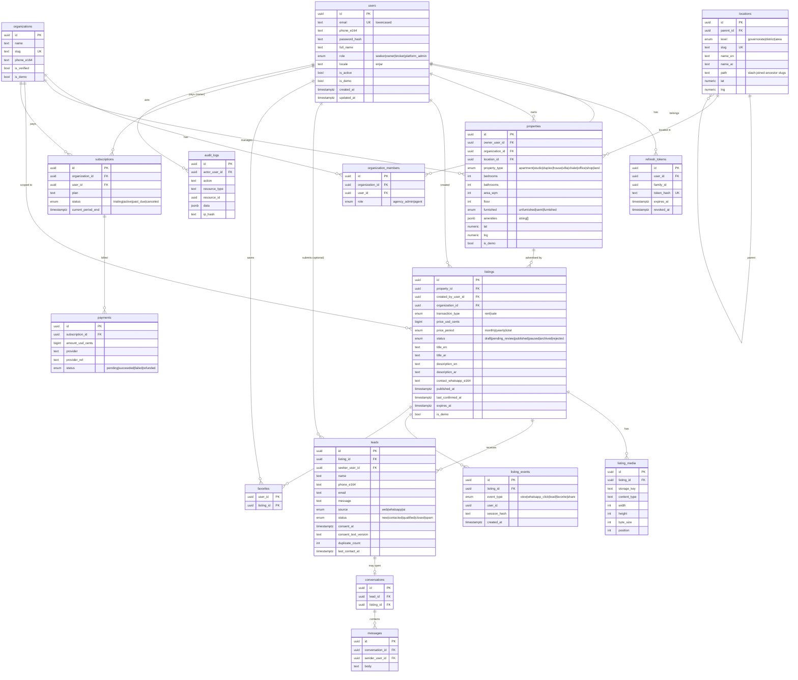

# Database

PostgreSQL 16. All primary keys are UUID (generated in the app, `uuid4`), all timestamps `timestamptz` in UTC.
Schema changes only through Alembic migrations in `apps/api/migrations`. Migrations follow
**expand → migrate → contract** so a previous API release keeps working during rollback.

## Principles

- **Property vs. listing**: `properties` describe the physical unit (location, rooms, area). `listings` are
  advertisements of a property (transaction type, price, status, publisher, text). One property can have
  several listings over time (rent now, sale later; re-listed next year) and moderation acts on listings.
- **Tenancy**: `listings.organization_id` (nullable for individual owners) scopes broker data.
- **Demo data**: `is_demo` boolean on users, organizations, properties, listings.
- **No vector store** in MVP; AI search uses structured filters. Revisit with `pgvector` only when
  evaluation shows semantic recall problems (ADR-005).
- **Geo**: `lat/lng numeric(9,6)`; PostGIS optional later (ADR-004).

## ERD

Tables marked *(M1)* are created in the first migration; others are designed and added in their milestone.

## Milestone mapping

| Table | Milestone |
|---|---|
| users, organizations, organization_members, refresh_tokens, locations, properties, listings, listing_media, leads, listing_events, audit_logs | M1 |
| favorites | M2 |
| ai_requests (telemetry) | M3 |
| conversations, messages | M4 (optional; WhatsApp is primary) |
| subscriptions, payments | M6 (pending monetization decision) |

## Indexes (M1)

- `users(email)` unique (stored lowercased)
- `locations(parent_id)`, `locations(path text_pattern_ops)` for descendant `LIKE 'beirut/%'`
- `properties(location_id)`, `properties(bedrooms)`
- `listings(status, transaction_type, published_at desc)` — main public query
- `listings(price_usd_cents)`, `listings(created_by_user_id)`, `listings(organization_id)`, `listings(expires_at)`
- `listing_media(listing_id, position)`
- `leads(listing_id, created_at)`, `leads(listing_id, phone_e164, created_at)` (dedupe lookup)
- `listing_events(listing_id, event_type, created_at)`
- `audit_logs(resource_type, resource_id)`

## Lead deduplication

Within a transaction the API takes `pg_advisory_xact_lock(hash('lead:' || listing_id || ':' || phone_e164))`,
then looks for a lead for the same listing and normalized phone created in the last 24 hours. If found it increments
`duplicate_count`, updates `last_contact_at`, appends the new message, and returns the existing lead (HTTP 200 instead
of 201). The advisory lock makes concurrent duplicate submissions race-free without a unique constraint.

## Demo data

`apps/api/app/seed.py` inserts Lebanese locations (real geography, public knowledge) and ~30 synthetic listings with
`is_demo = true`, placeholder publisher accounts `*@demo.2ajar.invalid`, and fake phone numbers in the `+961 70 000 xxx`
range. The production configuration refuses to run the seed (`ENV=production` guard) and public endpoints hide
`is_demo` rows unless `DEMO_MODE=true`.

## Backups

Railway Postgres: enable scheduled backups (daily, 7-day retention minimum) plus a manual `pg_dump` before every
migration that drops or rewrites data. See DEPLOYMENT.md.
